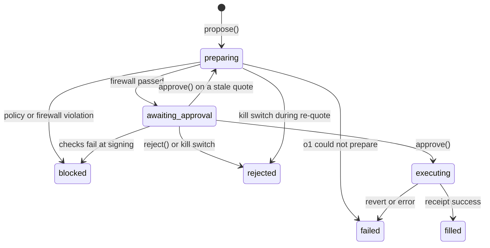

# Agent

`agent/` is the TypeScript service that decides what to buy, checks every trade against hard limits, and signs only after a human approves. It also serves the dashboard, a REST + SSE API, and an MCP server for AI clients.

Stack: Node 22, [Hono](https://hono.dev), [viem](https://viem.sh), Anvil (Foundry) for the Base fork, the MCP TypeScript SDK.

## Modules

| File | Does |
|---|---|
| `server.ts` | HTTP: REST API, SSE stream, token images, dashboard static files. Runs `agent.refresh()` every 3 s. |
| `agent.ts` | The `Agent` class: token table, proposals, approval flow, kill switch, demo reset, persistence. |
| `rules.ts` | Safety screen: five checks per token from indexer data. |
| `policy.ts` | Hard limits: `checkIntent` before prepare, `checkPrepared` on the unsigned tx. |
| `o1.ts` | o1 Trading API: `POST /api/v2/order` (prepare) and `/api/v2/order/complete` (submit, live only). |
| `executor.ts` | Signs and sends on a fresh Base fork (demo, fork) or through o1 (live). |
| `price.ts` | ETH/USD spot from Coinbase, cached 60 s. |
| `metadata.ts` | Token images from `ipfs://` metadata, validated and cached on disk. |
| `mcp.ts` | MCP server: read, propose and kill-switch tools. No approve tool. |
| `config.ts` | Environment: mode, keys, URLs, state path. |

## Request flow

```mermaid
flowchart LR
  idx[indexer /tokens] -->|every 3 s| refresh
  refresh --> screen[rules.screen]
  screen -->|pass + autoPropose| propose
  ui[dashboard / MCP] -->|POST /api/proposals| propose
  propose --> intent[policy.checkIntent]
  intent -->|violations| blocked([blocked])
  intent --> prepare[o1 prepareOrder]
  prepare --> fw[policy.checkPrepared]
  fw -->|violations| blocked
  fw --> wait([awaiting_approval])
  wait -->|human approves| approve
  approve --> stale{quote older<br/>than 60 s?}
  stale -- yes --> prepare
  stale -- no --> again[re-run checkIntent<br/>+ checkPrepared]
  again --> queue[one-at-a-time queue<br/>kill switch re-checked]
  queue --> exec[executor.execute]
  exec --> done([filled / failed])
```

## Proposal states

A restart marks any `preparing` or `executing` proposal as `failed`, and an interrupted `executing` one still counts toward today's spend.

## Safety screen (`rules.ts`)

| Check | Default |
|---|---|
| Unique traders | ≥ 3 |
| Trades | ≥ 5 |
| Traders in first 60 s | ≤ 60% |
| Creator's launches (7 d) | ≤ 3 |
| Token age | ≤ 72 h |

When the token allowlist is set, only listed tokens can be bought and they skip the screen. Otherwise a token must pass every check.

## Policy and firewall (`policy.ts`)

`checkIntent` runs before anything is prepared: kill switch, Base only (8453), per-trade cap ($1), daily cap ($5), slippage cap (500 bps), allow/deny lists, safety screen.

`checkPrepared` runs on the transaction o1 returned, right before signing: chain id, target contract allowlist, `value` no higher than the approved ETH, and the wallet nonce in fork/live mode. o1 routes the trade; it never decides what gets signed.

Both run again at approval. Since [PR #15](https://github.com/jog01/o1-agent/pull/15), if the order is older than 60 s (o1 orders expire about 5 minutes after preparing), approval first asks o1 for a fresh one: ETH is re-priced from the confirmed USD amount using a fresh ETH price, never above the ETH amount that was reviewed.

## Execution modes (`executor.ts`)

| Mode | Signer | Where the tx lands | Money |
|---|---|---|---|
| `demo` (default) | `DEMO_SIGNER`, impersonated on Anvil | Local fork reset to the latest Base block | None |
| `fork` | `WALLET_PRIVATE_KEY` signs a raw tx | Local fork | None |
| `live` | `WALLET_PRIVATE_KEY`, submitted via o1 `/order/complete` | Base mainnet | Real; also needs `LIVE_TRADING=I_UNDERSTAND_THIS_SPENDS_REAL_MONEY` |

Each fork trade resets Anvil to the latest block first, so the fork matches what o1 quoted against. Trades run one at a time through a queue, and the queue re-checks the kill switch just before sending.

## API

| Method | Path | Auth |
|---|---|---|
| GET | `/api/health`, `/api/state`, `/api/events` (SSE) | none |
| GET | `/api/token-image/:token` | none |
| POST | `/api/proposals` | none (unauthenticated callers are tagged `mcp`) |
| POST | `/api/proposals/:id/approve`, `/reject` | approver token |
| POST | `/api/scan` | approver token |
| POST | `/api/kill` | none to turn on, approver token to turn off |
| PATCH | `/api/policy`, `/api/rules` | approver token |
| POST | `/api/demo/reset` | approver token, demo mode only |

`APPROVER_TOKEN` (16+ characters) is required in fork and live mode and sent as `x-approver-token`.

## MCP tools (`mcp.ts`)

`list_launches`, `get_policy`, `propose_buy`, `list_proposals`, `kill_switch`. An AI client can find and propose trades and stop trading; only a human can approve.

## State

Policy, rules and the last 200 proposals are written to `data/agent-state.json` (`STATE_PATH`) on every change. The activity log lives in memory.
