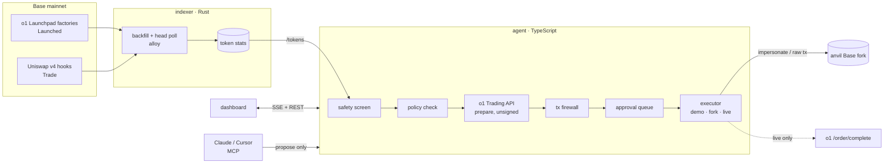
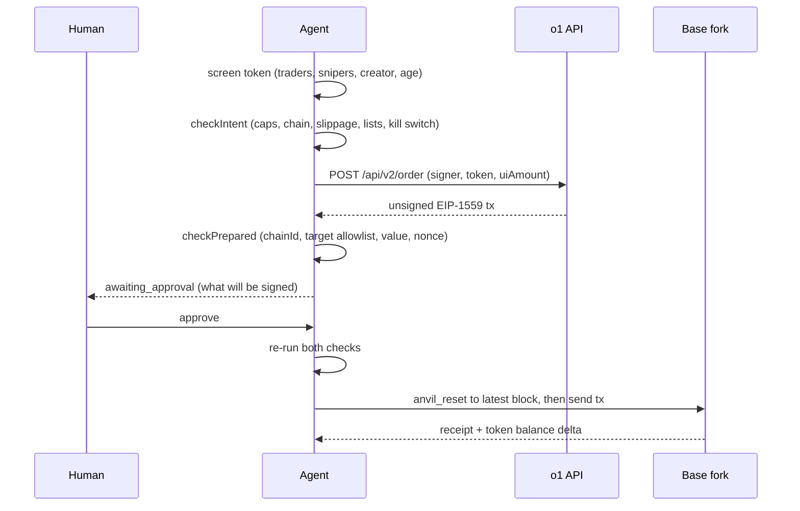

# Architecture

## Trade lifecycle

## Why these choices

- **Indexer reads the chain directly.** o1's Launchpad emits `Launched` on each factory and `Trade` on each v4 hook. Reading these with no third-party API keeps the data honest and fast: a 7-day backfill over all four Base suites takes about 3 s (100 ms per 10k-block range).
- **Sniper signal from raw trades.** The share of unique traders who bought in the first 60 s is a cheap, robust proxy for bundled or sniped launches.
- **The API routes; the wallet decides.** o1's prepared transaction is decoded and checked before signing. On the first live run the firewall blocked an unfamiliar o1 router until it was explicitly allowlisted, which is the point.
- **The fork is reset to the latest block per trade.** That way the fork state matches what o1 quoted against, so fills are realistic.
- **MCP can propose, not sign.** This matches o1's documented safe agent workflow: read, prepare unsigned, show, then a human signs.

## Not done yet

- Sells: o1 returns Permit2 typed data for sells. The executor refuses Permit2 orders until signing them is added.
- Positions and PnL tracking across fork resets.
- WebSocket head subscription instead of 1.5 s polling.
