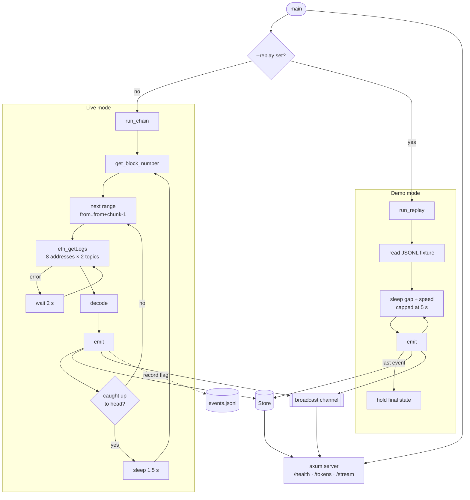
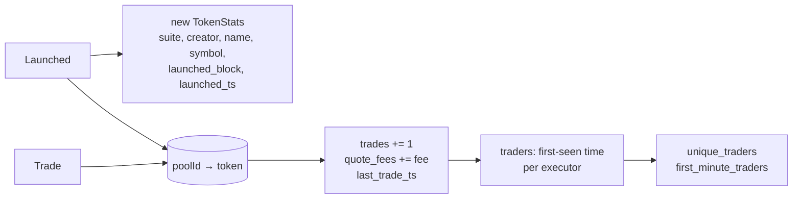

# Indexer

`indexer/` is one Rust binary (`src/main.rs`) that reads the o1 Launchpad straight from Base, keeps per-token stats in memory and serves them over HTTP and WebSocket. It uses no third-party data API: only a Base JSON-RPC endpoint.

Stack: [alloy](https://alloy.rs) for RPC and ABI decoding, [axum](https://github.com/tokio-rs/axum) for HTTP/WebSocket, tokio for async.

## What it watches

o1 runs four Launchpad suites on Base. Each suite is a factory (emits `Launched`) plus a Uniswap v4 hook (emits `Trade`).

| Suite | Factory | Hook |
|---|---|---|
| standard | `0x1176122eb77AD6a2339322Cda7C4D7ea9BfA63dC` | `0x1f91c998e7c2F4b690D75BDBf6502BDcD6e02AcC` |
| tax | `0x53C59d8d335681d58F564cF62073fA3C57cF81ee` | `0x9C7155D7216454D9d894F792c8B5C564F2c66AcC` |
| wstO | `0xAC7Bd3254d7182a32ae3Ce7Fcd0ab86c88fcD91F` | `0xAa4B4fABf41754E759338778e6031A156EeA6aCc` |
| pads | `0xfF6ff1DFa6938707Db8dD78D7E74999e8177126f` | `0xFe97d6f3f59Ec48f2953c702e55e0ca199392aCC` |

```solidity
event Launched(address indexed token, bytes32 indexed poolId, address indexed originalCreator,
               address quoteToken, uint256 launchSupply, int24 tickSpacing);
event Trade(bytes32 indexed poolId, address indexed executor, address indexed referrer,
            address quoteCurrency, uint256 quoteFeeAmount, bytes32 comment);
```

A `Trade` only carries the `poolId`, so the indexer keeps a `poolId → token` map built from `Launched`.

## How it runs



1. **Backfill.** On start it reads the head block and goes back `--backfill` blocks (default 43,200 = 1 day; `scripts/start.sh` uses 302,400 = 7 days).
2. **One filter for everything.** A single `eth_getLogs` covers all 8 contracts and both event signatures, in `--chunk` block ranges (default 5,000). A 7-day backfill over all four suites takes about 3 s.
3. **Decode.** Each log is matched to its suite by contract address, then decoded as `Launched` or `Trade`. Block timestamps come from the log or a per-block cache (cleared past 10,000 entries). For a launch it also calls the token's `name()` and `symbol()`.
4. **Emit.** Every event is applied to the store, appended to the recording file if `--record` is set, and broadcast to WebSocket clients.
5. **Follow the head.** Once caught up it polls for new blocks every 1.5 s. A failed range is retried after 2 s without skipping blocks.

## Per-token stats

`Store::apply` folds events into a `TokenStats` per token:



- `unique_traders`: distinct `executor` addresses.
- `first_minute_traders`: traders whose first trade landed within 60 s of the launch. The agent divides this by `unique_traders` to get the sniper share, a cheap signal for bundled or sniped launches.
- Trades for a pool the indexer never saw launch (older than the backfill) are ignored.

## API

| Endpoint | Returns |
|---|---|
| `GET /health` | `{ ok, head_block, tokens, events }` |
| `GET /tokens` | Every `TokenStats`, newest launch first |
| `GET /stream` | WebSocket: every `launch` / `trade` event as JSON, as it is applied |

The agent polls `/tokens` every 3 s.

## Record and replay

`--record events.jsonl` appends every event to a file. `--replay events.jsonl --speed 60` plays a file back instead of reading the chain, paced by the original block timestamps divided by `speed` (gaps capped at 5 s), then holds the final state so the feed never empties mid-demo.

`indexer/fixtures/base-launchpad-7d.jsonl` is a 7-day recording (2,323 events) used by `INDEXER_REPLAY=1 ./scripts/start.sh`.

## Flags

| Flag | Env | Default |
|---|---|---|
| `--rpc` | `BASE_RPC_URL` | `https://base-rpc.publicnode.com` |
| `--listen` | | `0.0.0.0:7070` |
| `--backfill` | | `43200` blocks |
| `--chunk` | | `5000` blocks |
| `--record` | | off |
| `--replay` | | off |
| `--speed` | | `60` |
