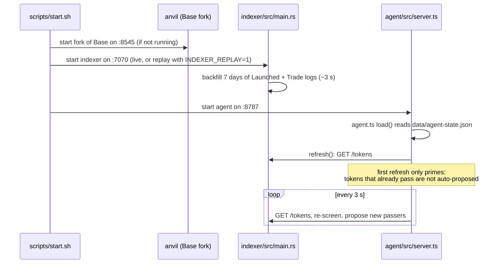
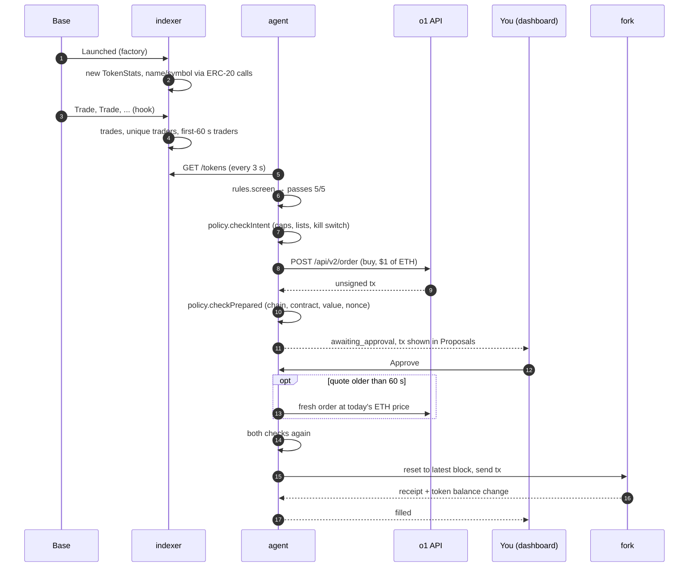

# Timeline: what runs, in order

Two walkthroughs: the stack starting up, then one token going from launch to a filled buy. Each step names the file that does it.

## 1. Startup

| Step | File | What happens |
|---|---|---|
| 1 | `scripts/start.sh` | Starts Anvil forking Base (chain id 8453) unless one is already up. |
| 2 | `scripts/start.sh` → `indexer/src/main.rs` | Starts the indexer: live from RPC, or replaying `indexer/fixtures/base-launchpad-7d.jsonl`. |
| 3 | `indexer/src/main.rs` `run_chain` | Backfills 302,400 blocks in 5,000-block ranges, then polls the head every 1.5 s. |
| 4 | `agent/src/server.ts` | Builds the `Agent`, mounts the API, serves `web/dist`, starts the 3 s refresh loop. |
| 5 | `agent/src/agent.ts` `load()` | Restores policy, rules and proposals; any proposal cut off mid-trade is marked failed. |
| 6 | `agent/src/agent.ts` `refresh()` | First pull of `/tokens`: screens everything, but only remembers what passes so old tokens are not bought on boot. |

## 2. One trade, launch to fill

| Time | File | Event |
|---|---|---|
| T+0 | Base | Creator launches; the factory emits `Launched`. |
| ≤ T+2 s | `indexer/src/main.rs` | Head poll picks up the block, decodes `Launched`, reads `name()` / `symbol()`, broadcasts it. |
| ≤ T+5 s | `agent/src/agent.ts` `refresh()` | Token appears in the Feed. It usually fails the screen at first: not enough trades or traders yet. |
| minutes | `indexer/src/main.rs` `Store::apply` | Each `Trade` updates trades, unique traders and first-minute traders. |
| when it passes | `agent/src/rules.ts` `screen()` | All five checks pass; with auto-propose on, `propose()` runs once for this token. |
| +0.1 s | `agent/src/policy.ts` `checkIntent()` | Kill switch, chain, $1 / $5 caps, slippage, lists. |
| +1 s | `agent/src/o1.ts` `prepareOrder()` | o1 returns the unsigned EIP-1559 transaction. |
| +1 s | `agent/src/policy.ts` `checkPrepared()` | Chain, allowed contract, value, nonce. Passes → `awaiting_approval`. |
| your click | `web/src/components/Proposals.tsx` | You review the token, contract, value and calldata, then approve. |
| +0–2 s | `agent/src/agent.ts` `approve()` | Re-quotes if older than 60 s, re-runs both checks, queues the trade. |
| +2 s | `agent/src/executor.ts` `execute()` | Resets the fork to the latest Base block and sends the transaction. |
| +3 s | `agent/src/executor.ts` | Receipt and token balance change; the proposal is `filled` and today's spend goes up. |

Every change is saved to `data/agent-state.json` and pushed to the dashboard over SSE within 150 ms.
