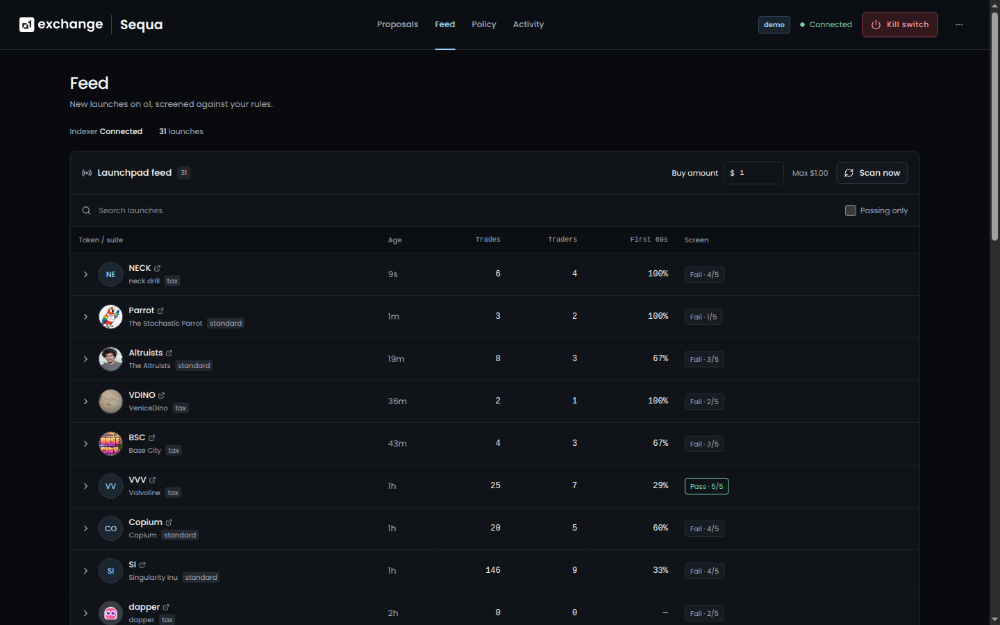
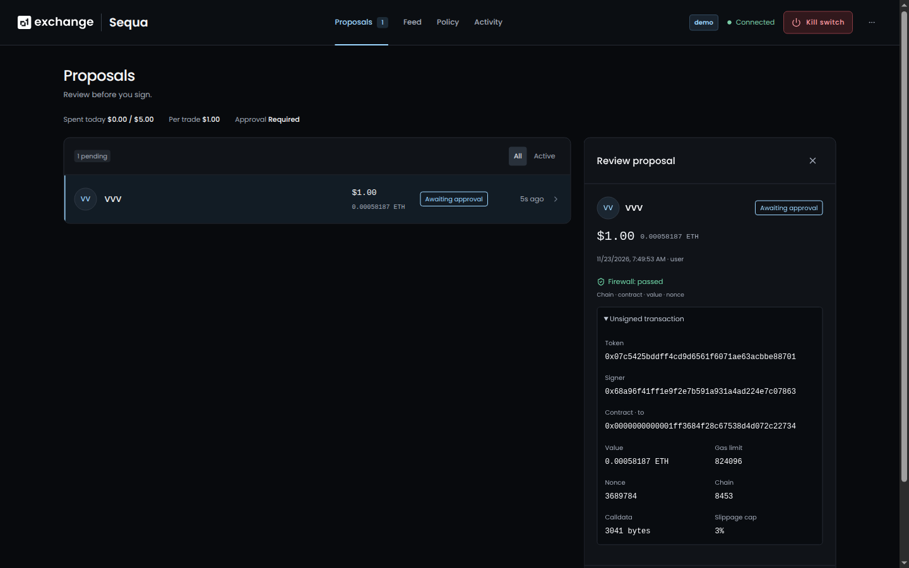
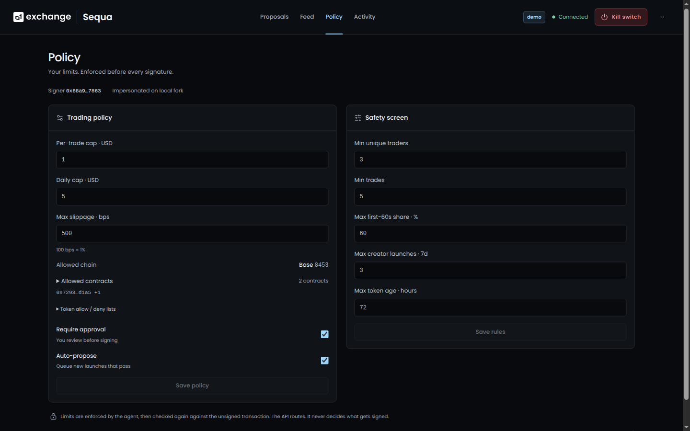
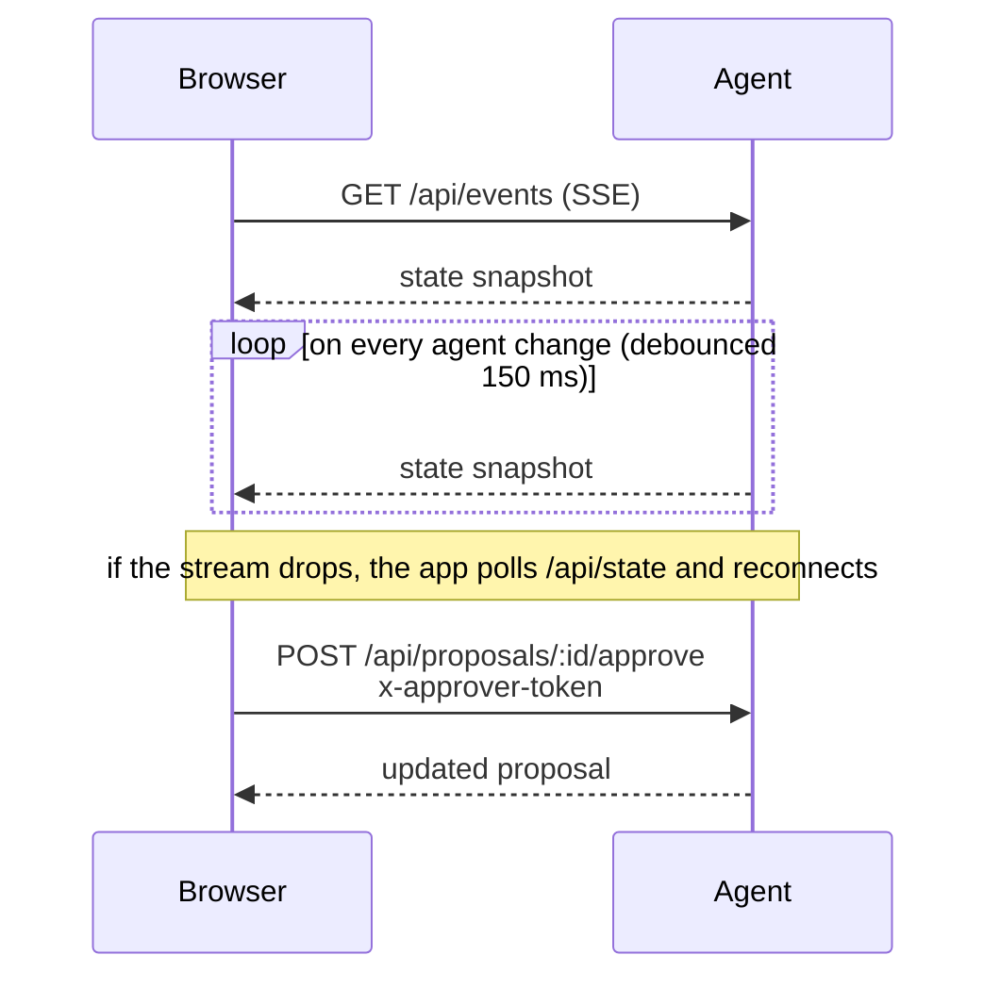

# Dashboard

`web/` is a React + Vite + Tailwind app, built to `web/dist` and served by the agent on the same port. It has four tabs under one navbar.

| Tab | Shows |
|---|---|
| Proposals | Pending and past buys, the unsigned transaction, approve / reject |
| Feed | Every o1 Launchpad token with its safety screen and a buy button |
| Policy | Trading limits, allowed contracts, token lists, safety-screen rules |
| Activity | The agent's log |

## Data flow

- `api.ts`: `request()` adds the approver token to every write, and `useAgent()` keeps one state object fed by SSE with a polling fallback. The connection badge shows live, polling or disconnected.
- `App.tsx`: shell, navbar, kill switch, demo reset, approver-token entry, notices.
- `components/`: `Launches` (Feed), `Proposals`, `Settings` (Policy), `Navigation` (tabs synced to the URL hash), `TokenAvatar` (token image with a letter fallback).
- The approver token is kept in `localStorage` and cleared on a 401.

## Look

o1's visual language: Poppins, pale blue `#9CD6FF` accents, dark panels, 1px dividers, tabular figures. Green and red are only for status.
